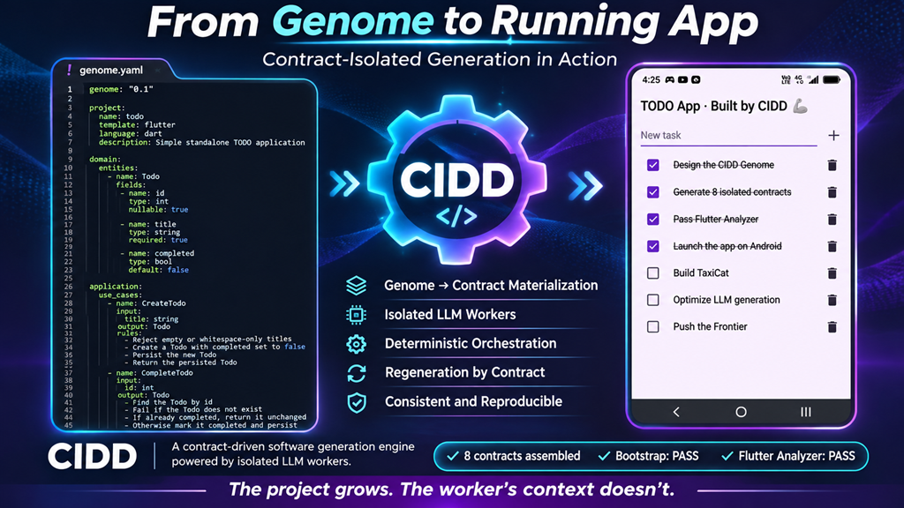

  

# 🦾 CIDD: Contract-Isolated Driven Development

CIDD generates robust, cross-platform software from a single declarative specification by breaking it down into a graph of isolated contracts that a Local LLM can resolve with 100% determinism.

> "CIDD doesn't make the model smarter. It makes the problem smaller." 🦾🖖

---

## 🚀 The Paradigm That Breaks the Token Limit

Unlike traditional autonomous agent architectures that bloat the context window, introduce infinite loops, and suffer from severe code drift, CIDD applies **Architectural Determinism via Micro-Contexts**. 

**The project grows. The worker's context doesn't.** By bounding every single generation task strictly underneath a 1K token threshold, CIDD shifts the development burden from expensive reasoning-heavy models to fast, hyper-focused local execution.

---

<!-- START OF EVALUATION SECTION -->

  

  <h2 style="color: #f0f6fc; border-bottom: 1px solid #30363d; padding-bottom: 8px;">📊 Evaluation & Case Studies</h2>
  
  <h3 style="color: #f0f6fc; margin-top: 20px;">Case Study 1: Standard Mobile TODO Application</h3>
  
A head-to-head comparison demonstrating the massive token overhead of standard multi-agent orchestration setups versus CIDD's deterministic contract isolation pipeline.

   

  <!-- MODERN DARK TABLE -->
  <table style="width: 100%; border-collapse: separate; border-spacing: 0; border: 1px solid #30363d; border-radius: 8px; overflow: hidden; background-color: #0d1117;">
    <thead>
      <tr style="background-color: #161b22;">
        <th align="left" style="padding: 14px; color: #f0f6fc; font-size: 15px; border-bottom: 1px solid #30363d; width: 50%;">🔄 Traditional Cloud Agents (Muse-Code)</th>
        <th align="left" style="padding: 14px; color: #58a6ff; font-size: 15px; border-bottom: 1px solid #30363d; width: 50%;">⚡ Deterministic Pipeline (CIDD)</th>
      </tr>
    </thead>
    <tbody>
      <tr>
        <!-- COLUMN 1: TRADITIONAL -->
        <td style="padding: 16px; vertical-align: top; border-right: 1px solid #30363d; line-height: 1.6;">
          
<strong style="color: #ff7b72;">Model:</strong> <code style="background-color: #21262d; padding: 3px 6px; border-radius: 6px; font-size: 13px; color: #ff7b72;">muse-wonder-1.0</code> (Medium)

          
<strong>Infrastructure:</strong> Cloud-orchestrated

          
<strong>Execution:</strong> 41 conversational turns

          
<strong>Volume:</strong> ~2,082,000 tokens

          
⚠️ High cloud API consumption fees

        </td>
        <!-- COLUMN 2: CIDD -->
        <td style="padding: 16px; vertical-align: top; background-color: #0f141c; line-height: 1.6;">
          
<strong style="color: #58a6ff;">Model:</strong> <code style="background-color: #1f2937; padding: 3px 6px; border-radius: 6px; font-size: 13px; color: #58a6ff;">Muse-Glimmer:30b</code> (No-think)

          
<strong>Infrastructure:</strong> 100% Local (RTX 5090)

          
<strong>Execution:</strong> Zero-turn direct compilation

          
<strong>Volume:</strong> ~11,000 tokens

          
🎉 $0.00 USD (100% Free)

        </td>
      </tr>
    </tbody>
  </table>

   

  <!-- BIG HERO METRIC HERO -->
  

    

      APLASTANTEMENTE DISRUPTIVO
    

    

      -99.4%
    

    

      Token Overhead Reduction
    

    

      CIDD eliminates the multi-agent cognitive overhead entirely, delivering flawless, deterministic compilation with local infrastructure at zero cost.
    

  

  

<!-- END OF EVALUATION SECTION -->
